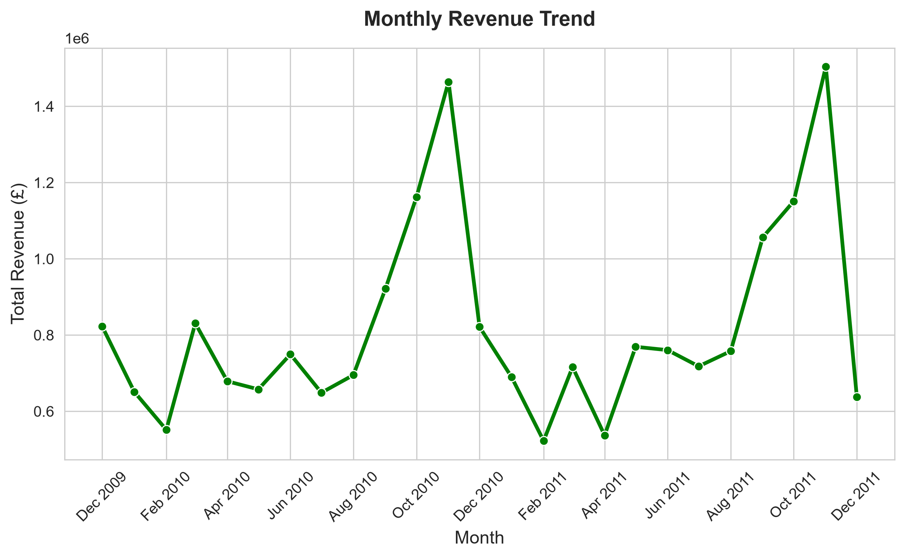
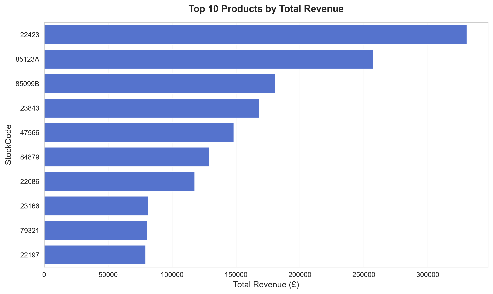
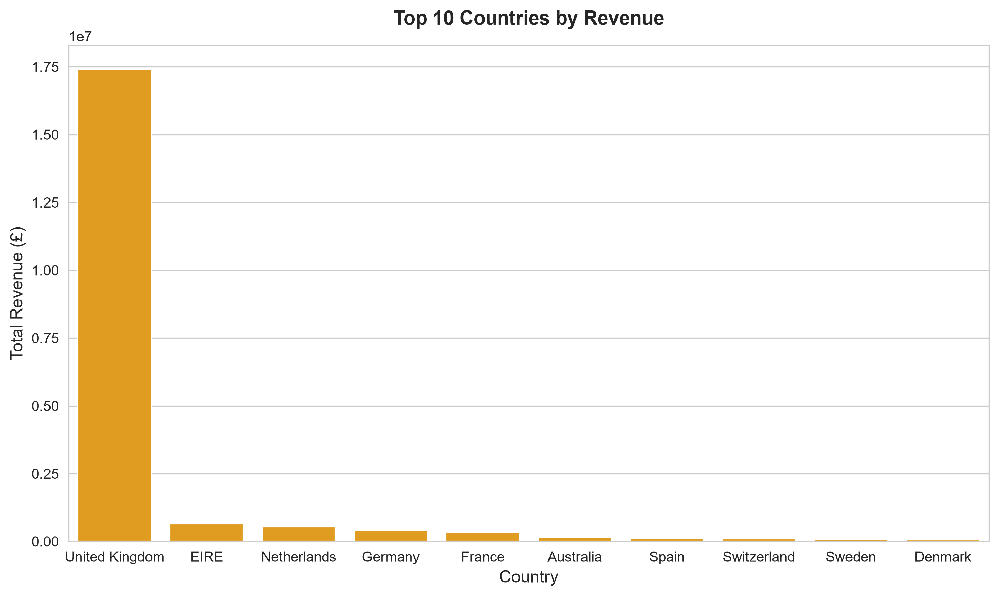
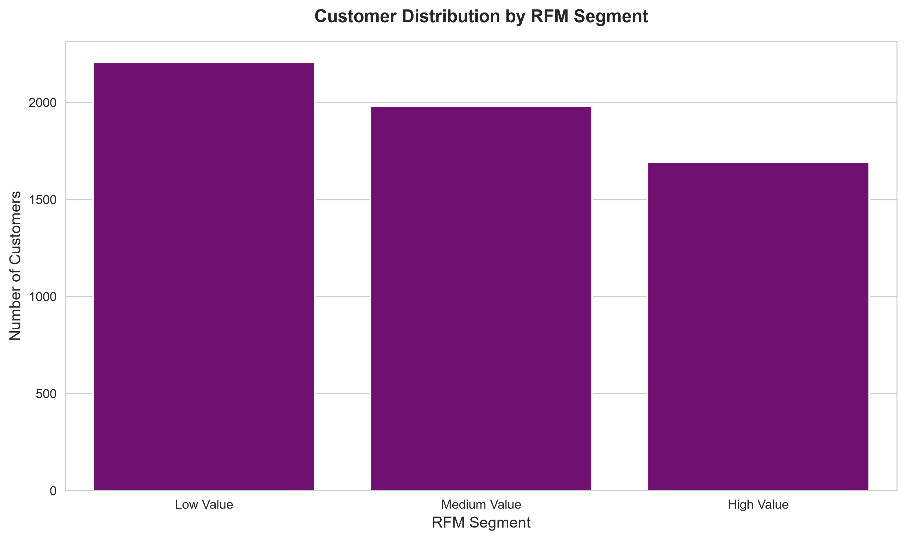
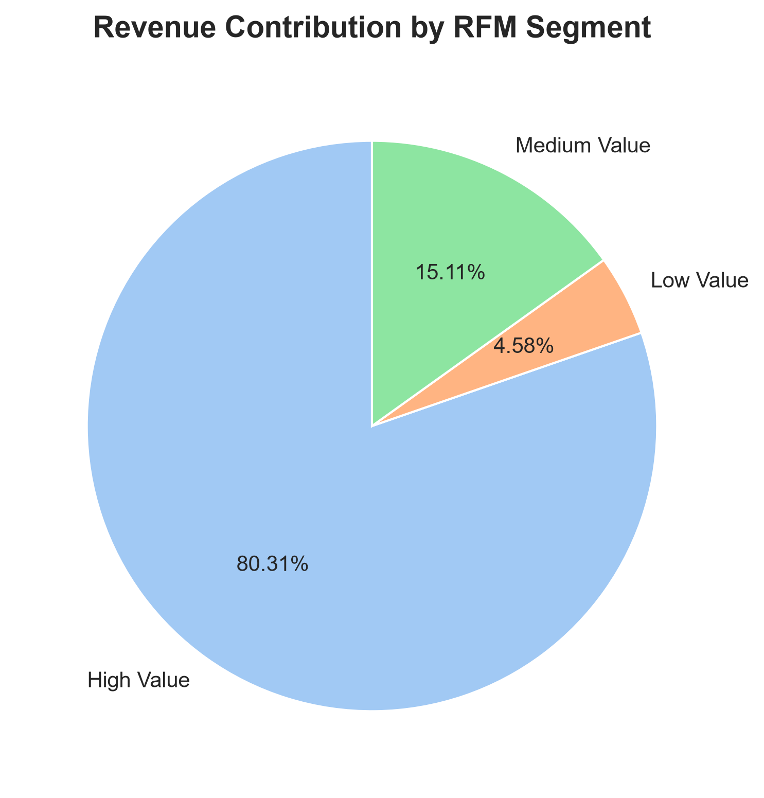
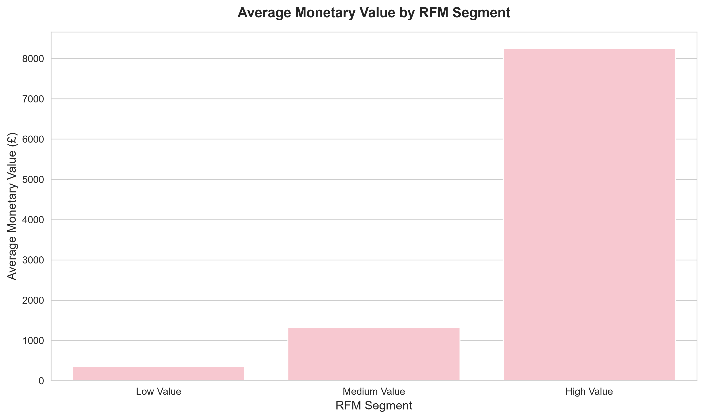

# Online Retail II — Sales & Customer Analysis with Python

## Project Overview

This project examines historical transaction data from the Online Retail II dataset to analyze sales performance, product trends, customer purchasing behavior, and customer segmentation.

The analysis includes transactions from December 2009 to December 2011 and utilizes Python for data cleaning, exploratory analysis, RFM segmentation, and visualization.

## Objectives

- Examine sales results on a monthly and annual basis.
- Evaluate the best-performing products and countries based on revenue.
- Analyze customer expenditure and recurring purchase patterns.
- Perform Recency, Frequency, and Monetary (RFM) analysis to segment customers.
- Visualize key findings to support data-driven business decisions.

## Tools & Libraries

- Python
- Pandas
- Matplotlib
- Seaborn
- OpenPyXL (Excel file reading)

## Analysis Workflow

### 1. Data Cleaning
Removed duplicate records, cancelled invoices, and transactions with non-positive quantities or prices. Handled missing product descriptions and calculated transaction revenue.

### 2. Sales & Product Analysis
Examined monthly growth, top-selling items, revenue patterns, and sales results at the national level.

### 3. Customer Analysis
Analyzed customer spending, frequency of purchases, rate of repeat purchases, and customer categories based on expenditure.

### 4. RFM Segmentation
Calculated Recency, Frequency, and Monetary metrics to classify customers with valid customer IDs into Low Value, Medium Value, and High Value segments.

### 5. Data Visualization
Six charts were generated to convey customer segment characteristics, product and country performance, and revenue trends.

## Key Findings

### Sales Performance
- Total revenue from positive transactions reached approximately **£20.48 million**.
- **November 2011** generated the highest monthly revenue, approximately **£1.50 million**.
- The United Kingdom accounted for approximately **85% of total revenue**, indicating a strong concentration in the domestic market.

### Customer Behavior
- The repeat purchase rate was **72.39%**, indicating that a substantial proportion of identified customers made multiple purchases.
- Customer spending varied considerably, highlighting differences in purchasing behavior.

### RFM Segmentation
- **High Value customers contributed 80.31%** of revenue associated with identified customers.
- High Value customers had higher average spending and more recent purchasing activity than Low Value customers.
- These findings suggest that customer retention and targeted engagement strategies could be valuable for the business.

## Visualizations

### 1. Monthly Revenue Trend

### 2. Top 10 Products by Revenue

### 3. Top 10 Countries by Revenue

### 4. Customer Distribution by RFM Segment

### 5. Revenue Contribution by RFM Segment

### 6. Average Monetary Value by RFM Segment

## Limitations

The dataset covers December 2009 to December 2011, with incomplete data for December 2011.

Cancelled invoices and non-positive transactions were excluded; therefore, the reported revenue represents positive transaction revenue rather than net revenue or profit.

Transactions without a valid Customer ID were excluded from customer-level and RFM analyses.

## Dataset Source

Dataset: Online Retail II  
Source: UCI Machine Learning Repository  
Link: https://archive.ics.uci.edu/dataset/502/online+retail+ii

The dataset contains transaction records from a UK-based online retailer between December 2009 and December 2011.